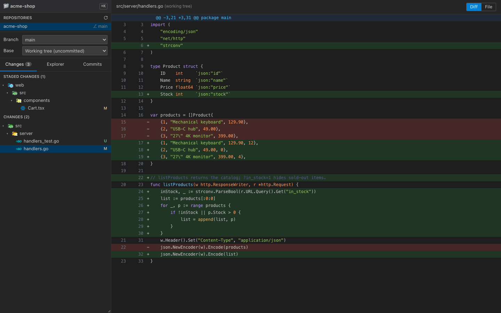
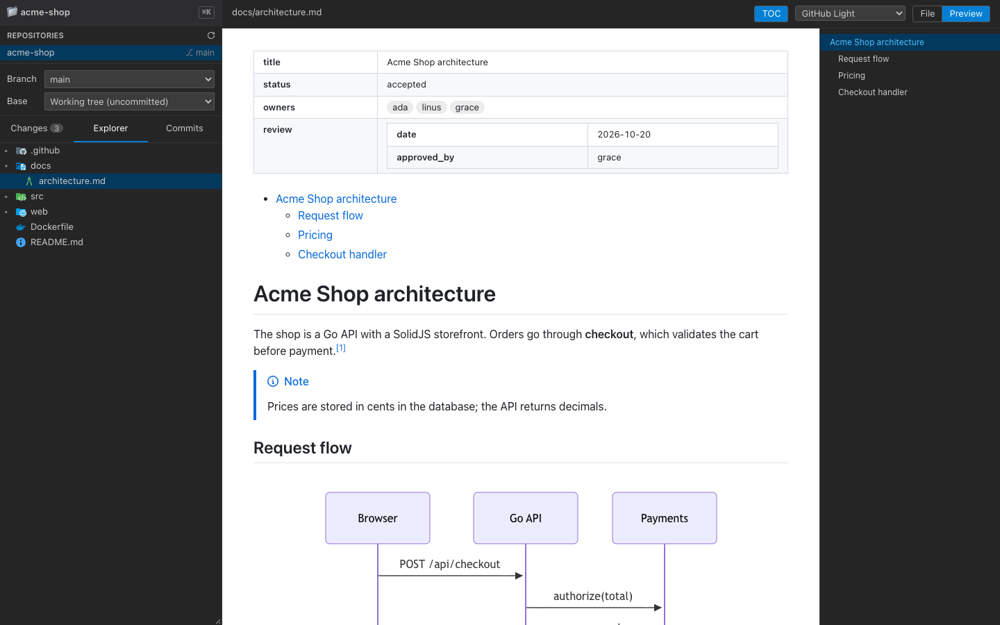
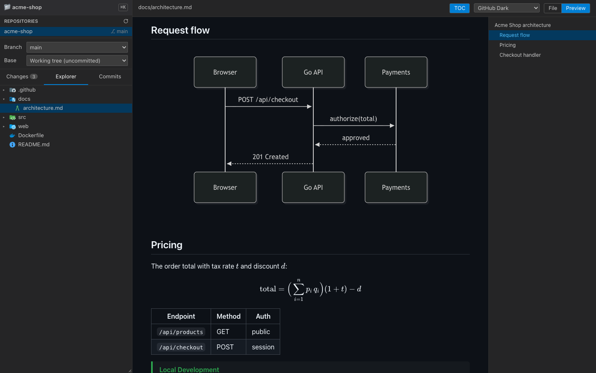
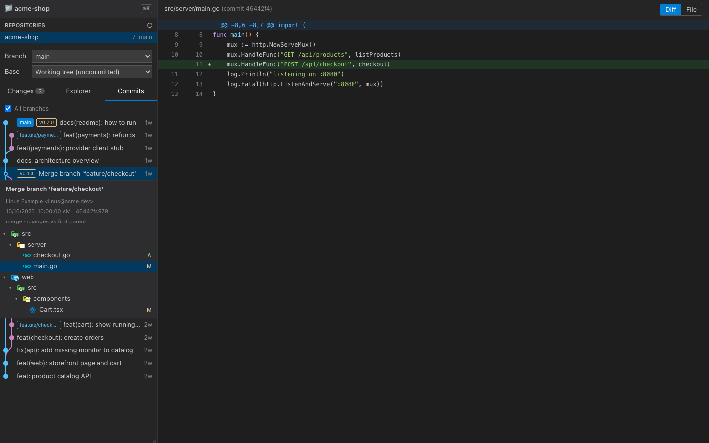
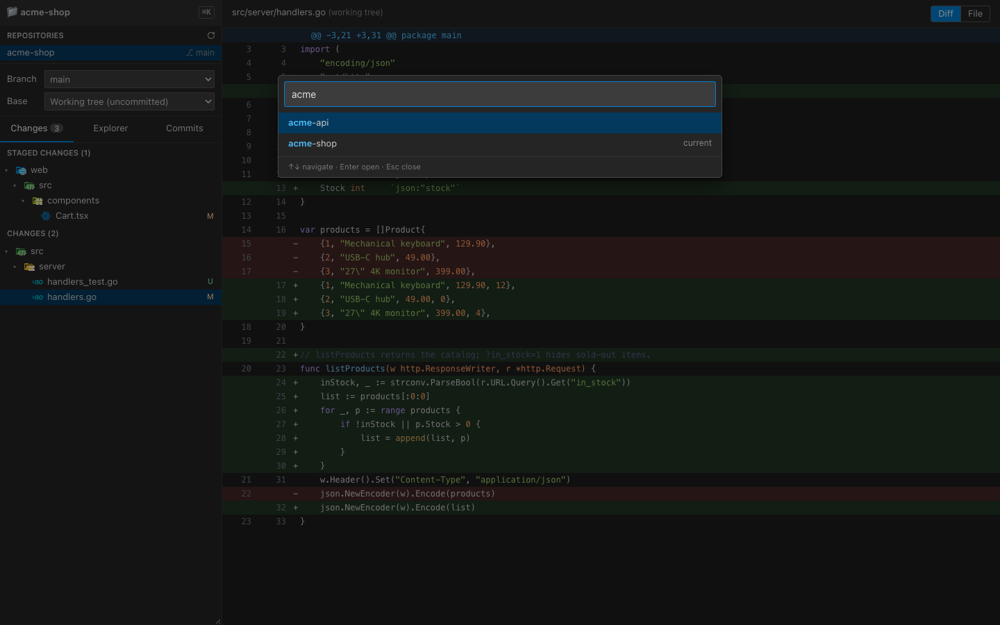
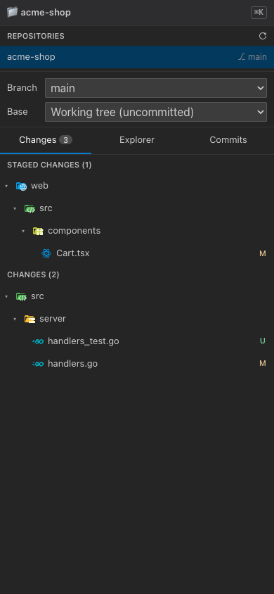
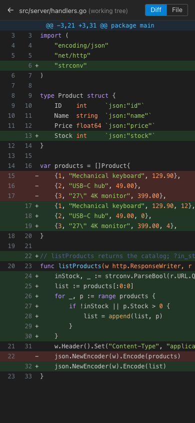

# webdiffviewer

A git diff viewer for the browser, in the style of VS Code's Source Control panel. The backend is Go and the UI is SolidJS, shipped as a single binary.

Run `webdiffviewer` in any folder and open your browser. It finds the repository and its submodules and shows branches, worktrees, the file tree, the changes tree and the commit graph, with syntax-highlighted diffs and a markdown preview modeled on [Markdown Preview Enhanced](https://github.com/shd101wyy/vscode-markdown-preview-enhanced).



## Screenshots

**Markdown preview:** YAML frontmatter as a table, table of contents, alerts, mermaid diagrams, KaTeX math. It has light and dark themes.

| GitHub Light | GitHub Dark |
|---|---|
|  |  |

**Commit graph:** branches, merges and tags. Opening a commit shows its message and changed files, and each file opens as a diff at that commit.



**Repository picker:** with `-parent-dir`, Ctrl/⌘+K opens a fuzzy search over every repo in that folder.



**Mobile:** on a phone you see the list or the open file. **←** goes back to the list, and swiping right-to-left on the list returns to the file.

<p>
  
  
</p>

## Features

- **Repositories:** the repo that contains the folder, plus every repo and submodule below it, with their worktrees. The scan goes 6 levels deep and skips `node_modules` and hidden folders.
- **Branches:** switch branches with `git switch`. Picking a remote branch creates the local tracking branch.
- **Changes:** staged and unstaged changes as a tree, with status letters (M, A, D, R, U).
- **Explorer:** the tree of tracked and untracked files, with each file's status.
- **Commits:** history with a branch/merge graph and branch/tag badges, for the current branch or **All branches**, 300 commits at a time. Merges are diffed against their first parent. Details are cached and prefetched on hover, so a commit opens almost instantly.
- **Base:** diff against another branch from the merge-base, like a pull request. The **Working tree** switch adds uncommitted and untracked changes; a **•** marks files with local edits. Turn it off to see only the branch's commits.
- **Views:** **Diff | File | Preview** in the top bar. *File* shows the whole file at the right version: the index for staged changes, `HEAD` for a branch comparison without the working tree, the commit in the Commits tab, otherwise the file on disk. Line-number columns that no row uses are hidden.
- **Syntax highlighting:** [Shiki](https://shiki.style), with VS Code's own TextMate grammars (240+ languages, including Vue, Angular templates, Svelte, Astro and MDX) and the Tokyo Night theme, for files and diffs up to 512KB. Each grammar loads only when a file needs it.
- **Icons:** [Material Icon Theme](https://github.com/material-extensions/vscode-material-icon-theme) (MIT) icons for files and folders, resolved the way VS Code does. The browser downloads only the icons on screen.
- **Markdown preview:** markdown-it with the same plugins as MPE:
  - YAML frontmatter as a table, `[TOC]`, footnotes, emoji, sub/sup, `==mark==`, abbreviations, definition lists and task lists;
  - KaTeX math (`$...$` and `$$...$$`), GitHub alerts (`> [!NOTE]`) and admonitions (`!!! tip`, collapsible `???`);
  - mermaid and Graphviz (```` ```dot ````) diagrams;
  - GitHub Light (default), Dark and Dark Dimmed themes;
  - relative images load from the repo, and relative links open inside the viewer;
  - a **TOC** panel next to the preview (an overlay on phones) that highlights the visible section.
- **Other repositories (`-parent-dir`):** the 📁 button and **Ctrl/⌘+K** open the fuzzy picker. The open repo lives in the URL (`?root=`), so each tab can show a different one.
- **Responsive:** up to 768px wide, the UI shows one pane at a time.
- **Refresh:** reloads when the window gains focus, or with the refresh button.

## Install

Download the binary for your platform from [Releases](https://github.com/andersou/webdiffviewer/releases): Linux, Windows and macOS, each for x64 and arm64. Every release includes `SHA256SUMS` to verify the downloads. You only need `git` installed.

```sh
# example: macOS on Apple Silicon
curl -LO https://github.com/andersou/webdiffviewer/releases/latest/download/SHA256SUMS
# download webdiffviewer-<version>-darwin-arm64.tar.gz from the release page, then:
shasum -a 256 -c SHA256SUMS --ignore-missing
tar -xzf webdiffviewer-*-darwin-arm64.tar.gz && ./webdiffviewer -version
```

### Build from source

Requires Go 1.24+, Node 20+ and git.

```sh
git clone https://github.com/andersou/webdiffviewer.git
cd webdiffviewer
make build      # installs dependencies, builds the frontend, compiles ./webdiffviewer
make install    # optional: copies it to $GOPATH/bin
```

The frontend is embedded in the binary (`go:embed`, in `web/embed.go`), so building Go needs `web/dist`, which only exists after `make build`.

## Usage

```sh
cd /some/repo
webdiffviewer                                # http://127.0.0.1:8080
webdiffviewer -port 9000 ../other-folder     # another folder and port
webdiffviewer -parent-dir ~/git              # Ctrl/⌘+K opens any repo in ~/git
webdiffviewer -host 0.0.0.0                  # reachable on the network (see Security)
```

| Flag | Default | Description |
|---|---|---|
| `-host` | `127.0.0.1` | Address to listen on |
| `-port` | `8080` | Port |
| `-parent-dir` | — | Folder whose repos the picker can open |
| `-check-ignore` | off | Never serve gitignored files (`.env` and other local secrets) |
| `-allowed-hosts` | — | Comma-separated host names accepted besides IPs and `localhost`, e.g. `mac.local` or a reverse-proxy domain |
| `-version` | — | Print the version and exit |
| `[dir]` | `.` | Folder to start in |

## Security

- By default the server listens on loopback only. However it is bound, it only answers requests whose `Host` header is an IP address, `localhost` or a name from `-allowed-hosts`. This blocks DNS rebinding (a website pointing its own domain at your machine so the visitor's browser reads it).
- **There is no authentication.** With `-host 0.0.0.0`, anyone on the network can read the files and switch branches. With `-parent-dir`, that applies to every repo in that folder.
- The API rejects paths that leave the repo, through `..` or symlinks, and any path into `.git` (remote URLs there can hold tokens). `-parent-dir` also rejects folders outside it.
- Gitignored files (like `.env`) can be opened by default. Use `-check-ignore` to hide them, especially with `-host 0.0.0.0`.
- Git output is capped (files 5MB, diffs 10MB), so a huge file in history can't exhaust memory.
- Only hex commit ids are accepted, so refs and options can't be injected into git commands.
- Markdown HTML is sanitized with DOMPurify. Raw files (`/api/raw`) are served with `Content-Security-Policy: sandbox`.
- Branch switching requires a JSON body, so another website open in the browser can't trigger it.

## Development

```sh
go run ./cmd/webdiffviewer &   # API on :8080 (needs web/dist: run make build once)
cd web && npm run dev          # Vite with hot reload; proxies /api to :8080
make test                      # Go and JS tests
```

### Releases

Releases are automatic: [semantic-release](https://github.com/semantic-release/semantic-release) reads commit messages in the [Conventional Commits](https://www.conventionalcommits.org/) format. `feat:` makes a minor release, `fix:` and `perf:` a patch release, and `!` or `BREAKING CHANGE` a major release. Other types (`docs:`, `ci:`, `chore:`…) don't make a release.

The `.github/workflows/ci-release.yml` workflow:
1. tests the project and builds the frontend once;
2. builds and tests the binary on native runners for all 6 targets, checking each binary's `-version`;
3. publishes the release with the archives and `SHA256SUMS`.

Pushing to `develop` publishes `-beta` pre-releases.

### Layout

```
cmd/webdiffviewer/       entry point: flags and server startup
internal/
  api/
    router.go            registers every route, the static frontend and middleware
    handler/<domain>/    thin HTTP handlers (workspace, branches, changes, files, commits):
                         router.go registers, get.go/post.go parse the request and call the service
    helpers/             JSON/text/error responses, repo and path validation
  git/                   data layer: runs git and parses its output (status, diff, log, worktrees)
services/<domain>/       business logic per domain: data.go (types), get.go/post.go (operations),
                         utils.go (private helpers)
pkg/
  apperr/                errors carrying an HTTP status, so services stay HTTP-free
  middleware/            Host check (DNS rebinding) and static file caching
web/embed.go             exposes the built frontend (go:embed can't reach parent folders)
web/src/
  App.jsx                selection state (folder, repo, base, open file) and the sidebar/viewer layout
  components/            Tree, Viewer, CodeView, MarkdownPreview, Commits, CommitGraph, Picker,
                         RepoList, BranchBar, ChangesPanel
    ui/                  presentational primitives: shared Panda styles, Switch
  hooks/                 createStoredSignal (localStorage), createSwipe, createWindowEvent, createCommitDetails
  lib/                   logic by domain, no UI
    api/                 API client
    git/                 diff parser, commit graph layout, status -> tree items
    markdown/            markdown-it engine and plugins, rendering, themes, frontmatter, admonitions
    icons/               Material Icon Theme lookup
    utils/               fuzzy search, link resolution
    highlight/           Shiki highlighting: file name -> language, lazy grammars and themes
```

Tests sit next to the code they cover (`*_test.go`, `*.test.js`). Styles use Panda CSS (`web/panda.config.ts`); `web/src/components/MarkdownPreview.css` adjusts the HTML generated from markdown. `npm install` copies the icon SVGs to `web/public/icons` (`web/scripts/copy-icons.js`). Screenshots in `docs/screenshots` come from a made-up demo repository.
